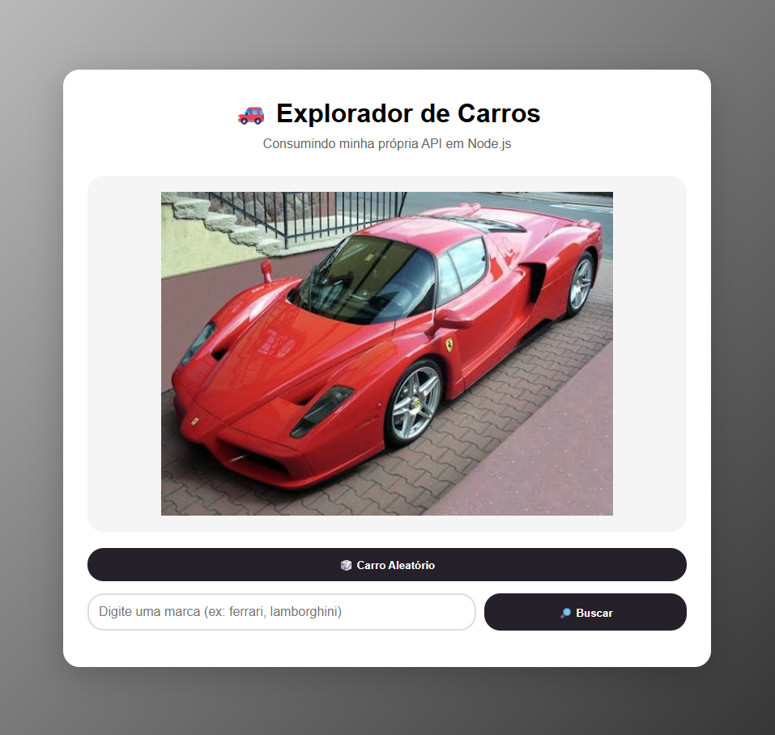
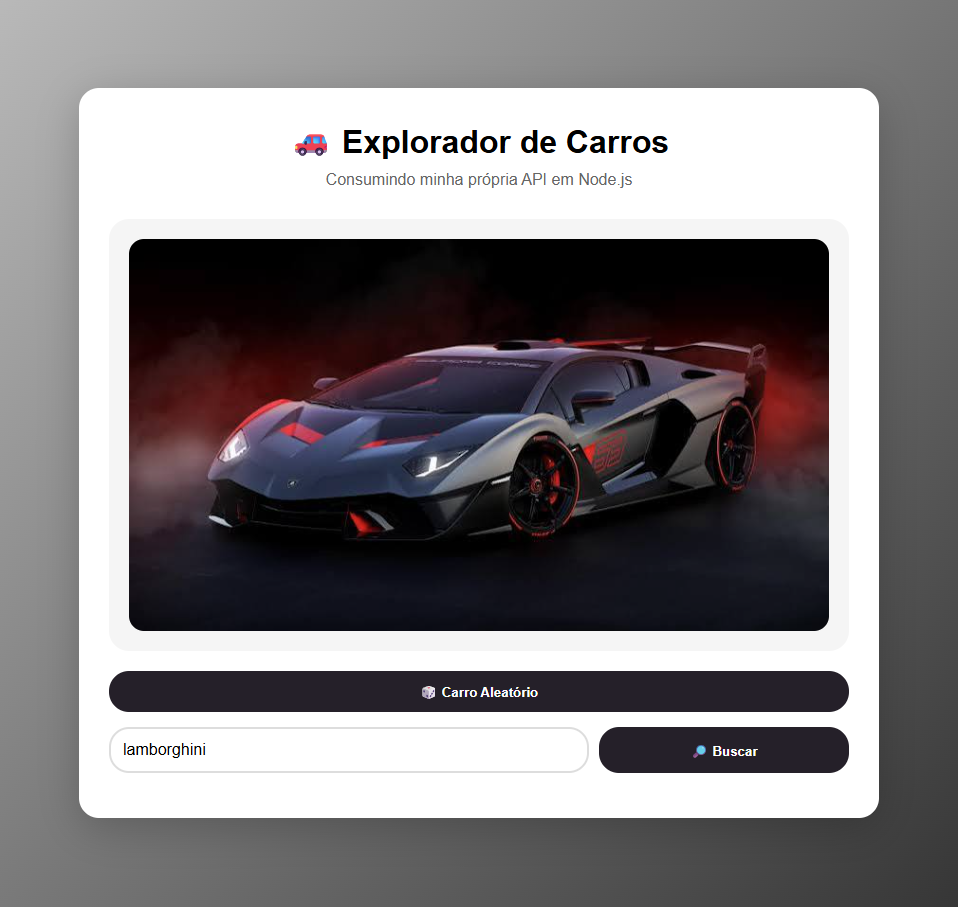
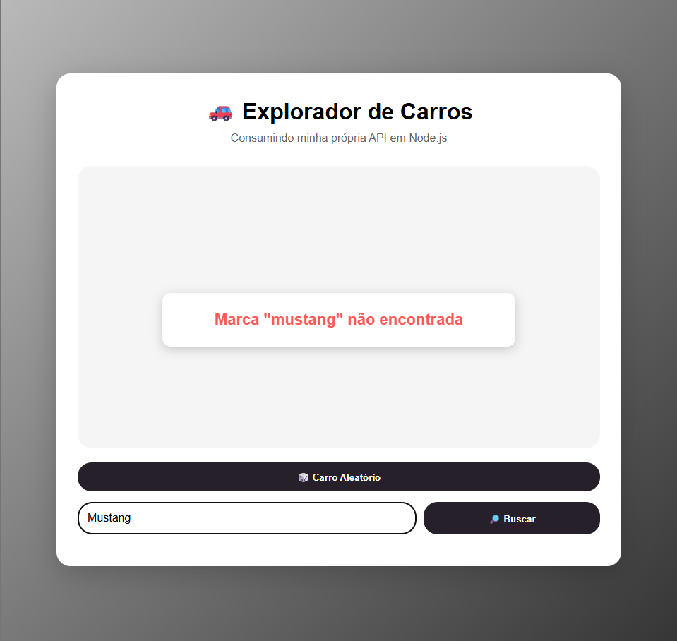

🚗 Car Explorer

O Car Explorer é um projeto desenvolvido com Node.js e Express que permite explorar carros por meio de uma API própria.
É possível sortear um carro aleatório ou pesquisar veículos por marca, visualizando suas imagens diretamente na página.

🛠️ Tecnologias utilizadas

- HTML
- CSS
- JavaScript
- Node.js
- Express
- API REST

▶️ Como executar o projeto

1. Instale o Node.js no computador.
2. Abra o terminal na pasta do projeto.
3. Instale as dependências:

   ```bash
   npm install
   ```

4. Inicie o servidor:

   ```bash
   node server.js
   ```

5. Abra o arquivo `index.html` no navegador, utilizando o Live Server do VS Code.

Importante: mantenha o servidor funcionando enquanto utiliza o site.

🔗 Rotas da API

| Método | Rota | Descrição |
|---|---|---|
| GET | `/api/carros/aleatorio` | Retorna um carro aleatório |
| GET | `/api/carros/:marca` | Retorna um carro de uma marca específica |

### Exemplos de utilização

- `http://localhost:3000/api/carros/aleatorio`
- `http://localhost:3000/api/carros/ferrari`

🚘 Categorias disponíveis

O Car Explorer possui quatro marcas de carros cadastradas:

- Ferrari
- Lamborghini
- Mercedes
- Porsche

📸 Prints do projeto

1. Carro aleatório



2. Busca por marca



3. Marca não encontrada



---------------------------------

ENZO DOMINONE BORDIN

DSI1 - SESI